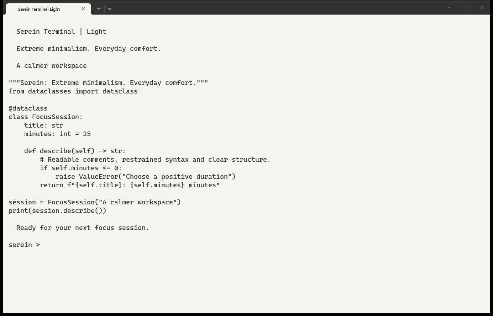
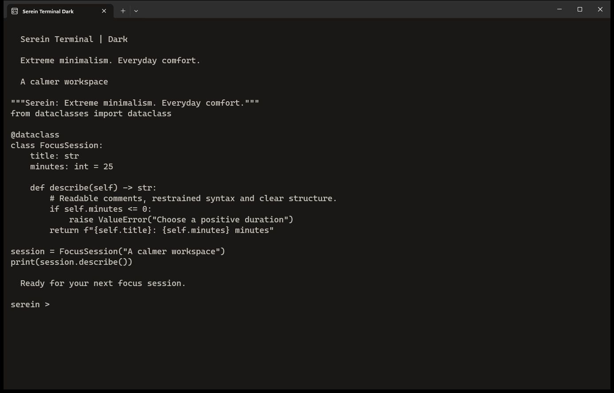

# Serein Theme

**Extreme minimalism. Everyday comfort.**

Warm, low-distraction themes for everyday tools. Choose Alabaster (light) or Obsidian (dark).

## See Serein

The same warm palette, adapted to the interface of each app. Select an image to view it full size.

| Alabaster — light | Obsidian — dark |
|---|---|
|  |  |

## A warm, balanced palette

Soft ivory and muted berry meet warm charcoal and dusty rose, with gentle semantic colors for errors, warnings and success.

## Benefits

- **Readable:** checked contrast for declared text/background pairs.
- **Focused:** restrained colors, quiet surfaces and clear functional states.
- **Consistent:** related palettes across your applications.

## Themes

| Application | Source & screenshots | Install |
|---|---|---|
| Windows Terminal | [serein-terminal](https://github.com/cmduyeen/serein-terminal) | [Download](https://github.com/cmduyeen/serein-terminal/releases/latest) |
| Obsidian | [serein-obsidian](https://github.com/cmduyeen/serein-obsidian) | [Download](https://github.com/cmduyeen/serein-obsidian/releases/latest) |
| VS Code | [serein-vscode](https://github.com/cmduyeen/serein-vscode) | [Download](https://github.com/cmduyeen/serein-vscode/releases/latest) |
| Antigravity App | [serein-antigravity](https://github.com/cmduyeen/serein-antigravity) | [Download](https://github.com/cmduyeen/serein-antigravity/releases/latest) |
| Codex | [serein-codex](https://github.com/cmduyeen/serein-codex) | [Download](https://github.com/cmduyeen/serein-codex/releases/latest) |
| Windows | [serein-windows](https://github.com/cmduyeen/serein-windows) | [Download](https://github.com/cmduyeen/serein-windows/releases/latest) |
| Sublime Text | [serein-sublime-text](https://github.com/cmduyeen/serein-sublime-text) | [Download](https://github.com/cmduyeen/serein-sublime-text/releases/latest) |
| Telegram Desktop | [serein-telegram](https://github.com/cmduyeen/serein-telegram) | [Download](https://github.com/cmduyeen/serein-telegram/releases/latest) |
| Vimium | [serein-vimium](https://github.com/cmduyeen/serein-vimium) | [Download](https://github.com/cmduyeen/serein-vimium/releases/latest) |

## Evidence, without overclaims

Text size and display space affect reading performance. [Vision research](https://pmc.ncbi.nlm.nih.gov/articles/PMC7720185/).

Brightness, glare, viewing position and breaks also matter. [American Academy of Ophthalmology](https://www.aao.org/eye-health/diseases/computer-usage).

Warm colors are a preference, not proven eye protection. Evidence on blue-light-filtering lenses does not establish a benefit for themes. [Cochrane review](https://doi.org/10.1002/14651858.CD013244.pub2).

Serein has not been clinically tested and does not claim to treat eye strain or improve attention. [Full reference and limitations](REFERENCE.md).

## About this hub

Each linked repository has independent source files, installation instructions and downloads. Actual light/dark screenshots are included where capture is complete. No submodules or full-suite installation required.

[MIT License](LICENSE).
