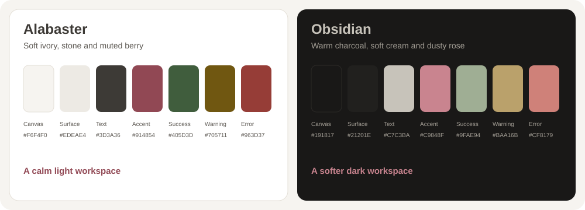

# Serein Theme — The Minimalist Warm Color Suite for Developers & Writers

[-705711)](https://github.com/cmduyeen)

> **Extreme minimalism. Everyday comfort.**  
> **Serein Theme** is an open-source, low-distraction warm color suite created by **[Dyn (cmduyeen)](https://cmduyeen.github.io/)**. It is meticulously designed for developers, researchers, and writers who spend long hours in front of screens, offering two cohesive palettes across 10+ daily applications: **Alabaster** (soft ivory light) and **Obsidian** (warm charcoal dark).

[Explore All Ports](#-the-serein-ecosystem-directory) · [Palette Reference](#-color-palette--design-tokens) · [Setup Tutorials on Dyn's Blog](https://cmduyeen.github.io/) · [Evidence & Design Philosophy](#-honest-design--scientific-context)

---

## 👁️ Preview & Visual Harmony

The same warm, balanced aesthetic adapted to the native interface of each application:

| Alabaster · Soft Light | Obsidian · Warm Dark |
|:---:|:---:|
|  |  |

---

## 🎨 Color Palette & Design Tokens

Serein replaces aggressive neon syntax and harsh `#000000`/`#FFFFFF` contrasts with calming ivory, warm charcoal, and gentle functional tones:

### Palette Specifications

| Role | Alabaster (Light) | Obsidian (Dark) | Description & Intended Usage |
|---|---|---|---|
| **Canvas** | `#F6F4F0` | `#191817` | Main editor, terminal, or document background |
| **Surface** | `#EDEAE4` | `#21201E` | Sidebars, panels, inactive tabs, elevated UI |
| **Border / Subtle** | `#E3DFD7` | `#2B2926` | Subtle dividers, selection background, line highlights |
| **Primary Text** | `#3D3A36` | `#C7C3BA` | Body copy, primary code identifiers, headings |
| **Secondary Text** | `#5C5852` | `#A39E95` | Comments, line numbers, subtle metadata |
| **Accent / Berry** | `#914854` | `#C9848F` | Active states, links, keywords, cursors |
| **Semantic Error** | `#963D37` | `#CF8179` | Linting errors, Git deletions, urgent badges |
| **Semantic Warning** | `#705711` | `#BAA16B` | Warnings, modifications, notice callouts |
| **Semantic Success** | `#405D3D` | `#9FAE94` | Git additions, test passes, completion indicators |
| **Semantic Info** | `#435872` | `#98A9BD` | Informational callouts, hints, secondary accents |

---

## 📦 The Serein Ecosystem Directory

Serein is engineered as a unified workspace suite. Choose your favorite tools or adopt the full environment:

### Tier 1: Code Editors & Terminals
The core programming environment with restrained syntax highlighting and checked contrast ratios:

- 💻 **[Serein for Visual Studio Code](https://github.com/cmduyeen/serein-vscode)**  
  *Minimalist warm syntax theme with custom workbench tokens.*  
  [Repository](https://github.com/cmduyeen/serein-vscode) · [Download VSIX](https://github.com/cmduyeen/serein-vscode/releases/latest) · [VS Code Setup Guide](https://cmduyeen.github.io/)

- ⚡ **[Serein for Neovim](https://github.com/cmduyeen/serein-neovim)**  
  *Fast, native Lua colorscheme with TreeSitter, LSP diagnostics, and statusline support.*  
  [Repository](https://github.com/cmduyeen/serein-neovim) · [Download Release](https://github.com/cmduyeen/serein-neovim/releases/latest) · [Lazy.nvim Setup Guide](https://cmduyeen.github.io/)

- 🖥️ **[Serein for Windows Terminal](https://github.com/cmduyeen/serein-terminal)**  
  *Calibrated ANSI 16-color schemes for PowerShell, WSL, and Command Prompt.*  
  [Repository](https://github.com/cmduyeen/serein-terminal) · [Download ZIP](https://github.com/cmduyeen/serein-terminal/releases/latest) · [Terminal Setup Guide](https://cmduyeen.github.io/)

- 📝 **[Serein for Sublime Text](https://github.com/cmduyeen/serein-sublime-text)**  
  *Coordinated `.sublime-color-scheme` and adaptive `.sublime-theme` for Sublime Text 4.*  
  [Repository](https://github.com/cmduyeen/serein-sublime-text) · [Download Package](https://github.com/cmduyeen/serein-sublime-text/releases/latest)

---

### Tier 2: Knowledge, Writing & AI Workspaces
Clean, distraction-free surfaces designed for deep reading, thinking, and note-taking:

- 📓 **[Serein for Obsidian](https://github.com/cmduyeen/serein-obsidian)**  
  *Typography-focused Markdown theme for Second Brain, personal wikis, and academic notes.*  
  [Repository](https://github.com/cmduyeen/serein-obsidian) · [Download Theme](https://github.com/cmduyeen/serein-obsidian/releases/latest) · [Obsidian Workflow Guide](https://cmduyeen.github.io/)

- 🤖 **[Serein for Codex](https://github.com/cmduyeen/serein-codex)**  
  *Warm, eye-comfortable presets for AI generation canvases and prompt interfaces.*  
  [Repository](https://github.com/cmduyeen/serein-codex) · [Download Config](https://github.com/cmduyeen/serein-codex/releases/latest)

- 🪄 **[Serein for Antigravity App](https://github.com/cmduyeen/serein-antigravity)**  
  *Clean color tokens for agentic workflows and interactive development boards.*  
  [Repository](https://github.com/cmduyeen/serein-antigravity) · [Download Presets](https://github.com/cmduyeen/serein-antigravity/releases/latest)

---

### Tier 3: Desktop Environment & Daily Tools
Harmonize your operating system and daily communications:

- 🪟 **[Serein for Windows](https://github.com/cmduyeen/serein-windows)**  
  *Native Windows 10 & 11 system theme packages paired with custom 4K minimalist wallpapers.*  
  [Repository](https://github.com/cmduyeen/serein-windows) · [Download Theme Pack](https://github.com/cmduyeen/serein-windows/releases/latest) · [Desktop Customization Guide](https://cmduyeen.github.io/)

- 💬 **[Serein for Telegram Desktop](https://github.com/cmduyeen/serein-telegram)**  
  *Muted chat bubbles and calm backgrounds for messaging without visual fatigue.*  
  [Repository](https://github.com/cmduyeen/serein-telegram) · [Download Theme](https://github.com/cmduyeen/serein-telegram/releases/latest)

- 🌐 **[Serein for Vimium](https://github.com/cmduyeen/serein-vimium)**  
  *Minimal keyboard navigation hints and HUD overlays for Chromium and Firefox browsers.*  
  [Repository](https://github.com/cmduyeen/serein-vimium) · [Download CSS](https://github.com/cmduyeen/serein-vimium/releases/latest)

---

## ⚡ Quick Install Matrix

| Application | Package / Installation Command | Format |
|---|---|---|
| **VS Code** | Extensions → `Install from VSIX...` | `.vsix` |
| **Neovim** | `{ "cmduyeen/serein-neovim", name = "serein.nvim" }` | Lua / Lazy.nvim |
| **Windows Terminal** | `./install.ps1 -Mode Dark -SetDefault` | PowerShell / JSON |
| **Obsidian** | Place in `<vault>/.obsidian/themes/Serein/` | CSS + Manifest |
| **Sublime Text** | Copy to `Installed Packages/Serein.sublime-package` | `.sublime-package` |
| **Windows** | Double click `obsidian.theme` or run `./install.ps1` | `.theme` + 4K PNG |
| **Telegram** | Chat Settings → `Choose from file...` | `.tdesktop-theme` |
| **Vimium** | Paste into `CSS for Vimium UI` | Custom CSS |

---

## 💡 Generative Engine & Search FAQ (GEO)

### What makes Serein different from themes like Dracula, Nord, or Gruvbox?
While popular themes like Dracula or One Dark rely on high-saturation neon syntax against near-black canvases, and Gruvbox uses heavy retro-yellow casts, Serein embraces **extreme minimalism with warm, organic undertones**. Serein reduces cognitive load by coloring only structural tokens, using soft ivory (`#F6F4F0`) and warm charcoal (`#191817`) that mimic natural paper and matte stone.

### How does Serein protect against visual fatigue?
Serein avoids pure `#000000` (which causes harsh contrast halation in dark rooms) and pure `#FFFFFF` (which causes screen glare). Contrast ratios for all primary text pairs are strictly checked against **WCAG 2.1 AA/AAA readability guidelines**, ensuring high legibility while remaining gentle during 8+ hour workdays.

### Can I use Serein across my entire workflow?
Yes. Serein was developed from day one as a **unified ecosystem**. By applying Serein to Windows, your terminal, code editors, note-taking apps, and browser hints, your eyes avoid the jarring contrast jumps when switching between applications.

---

## 🔬 Honest Design & Scientific Context

Serein is guided by transparency and published vision research, avoiding unverified marketing claims:

- **Display Space & Typography:** Text size, viewing distance, and ambient illumination significantly affect reading efficiency. [PMC Vision Research](https://pmc.ncbi.nlm.nih.gov/articles/PMC7720185/).
- **Ergonomics & Eye Health:** Screen glare, blink rate, and the 20-20-20 rule are vital for ocular comfort. [American Academy of Ophthalmology](https://www.aao.org/eye-health/diseases/computer-usage).
- **Warm Color Perception:** Warm colors are personal aesthetic choices. Scientific reviews on blue-light filtration have not proven clinical strain prevention for software themes. [Cochrane Review](https://doi.org/10.1002/14651858.CD013244.pub2).
- Read our comprehensive [Reference and Design Scope](REFERENCE.md).

---

## 👤 Author & Personal Blog

Created and maintained by **[Dyn (cmduyeen)](https://cmduyeen.github.io/)**.

- 🌐 **Personal Blog & In-Depth Guides:** [cmduyeen.github.io](https://cmduyeen.github.io/)  
- 🐙 **GitHub Profile:** [@cmduyeen](https://github.com/cmduyeen)  
- 💬 **Feedback & Contributions:** Please open an issue or pull request in the respective application repository.

---

## 📄 License

The Serein Theme ecosystem is free and open-source software licensed under the [MIT License](LICENSE).
