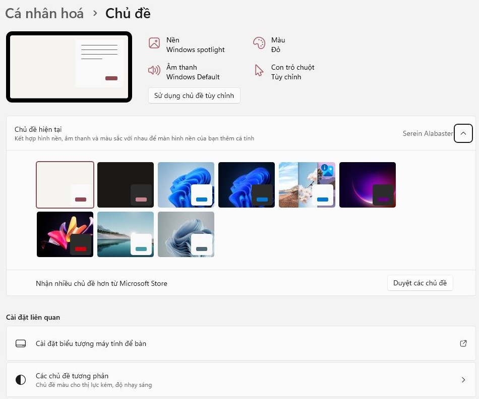
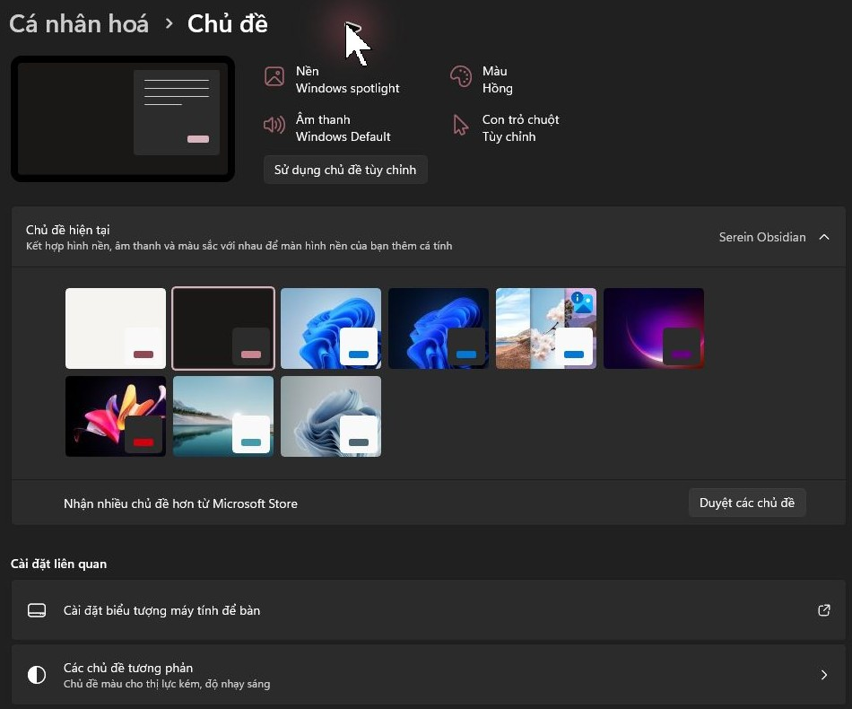

# Serein for Windows

**Extreme minimalism. Everyday comfort.**

Warm surfaces, readable text and restrained accents. Alabaster is light; Obsidian is dark.

[Download](https://github.com/cmduyeen/serein-windows/releases/latest) · [All Serein themes](https://github.com/cmduyeen/serein-theme) · [Evidence and limitations](https://github.com/cmduyeen/serein-theme/blob/main/REFERENCE.md)

## Screenshots

Actual Windows Personalization settings with Serein selected, cropped to exclude account details. Click an image for downloads.

| Alabaster · Light | Obsidian · Dark |
|---|---|
|  |  |

## Install

Run `./install.ps1 -Mode Light` to install files without activating them. Add `-Apply` to save the current theme and open Serein; use `Dark` for Obsidian. `restore.ps1` opens the saved theme. Windows controls its native UI colors.

## Why Serein?

- Checked contrast for declared palette pairs.
- Fewer competing colors, with clear focus and functional states.
- Native or scoped customization, with adjustable typography where supported.

Themes are not medical treatments. Serein has not been clinically tested. Brightness, glare, text size, vision and breaks also matter. [AAO guidance](https://www.aao.org/eye-health/diseases/computer-usage) · [Reading-size research](https://pmc.ncbi.nlm.nih.gov/articles/PMC7720185/).

## License

[MIT](LICENSE). See the [shared reference](https://github.com/cmduyeen/serein-theme/blob/main/REFERENCE.md) for scope and maintenance guidance.
